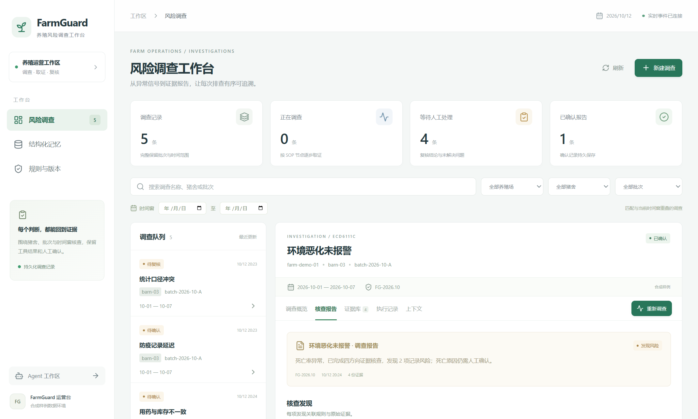

# FarmGuard

FarmGuard 是一个用于养殖场异常排查的桌面应用。围绕一个猪舍、批次和时间窗，它把死亡率、环境、用药库存、防疫记录串成调查 SOP，输出带证据引用的报告，并记录人工复核结果。



桌面实测截图：展示合成批次的调查记录、核查报告和证据入口。

## 启动

安装 Node.js 24 LTS 与 npm，然后双击 [启动FarmGuard.cmd](启动FarmGuard.cmd)。

也可在 PowerShell 执行：

```powershell
powershell -NoProfile -ExecutionPolicy Bypass -File ./Start-FarmGuard.ps1
```

首次启动按提示创建本地管理员。默认本地业务页为 `http://127.0.0.1:3111/farmguard`。

## 功能

- 按养殖场、猪舍、批次与时间窗创建案件。
- 根据死亡率门槛启动或终止异常调查。
- 展示环境曲线，核对报警、用药库存和防疫记录。
- 保存不可变证据快照、规则版本、SOP 步骤与 Trace。
- 生成可导出的风险报告，逐项查看引用证据。
- 记录人工确认与待核实事项。
- 检索事实、决策、经验、待办，先过滤业务范围和规则版本，再进行 BM25 排序。
- 预览上下文预算与节点拆分策略。
- 配置模型后，在案件专属 Agent 工作区进行证据复核。

## 样例与验证

随项目提供五类合成样例：正常批次、环境恶化未报警、用药库存差异、防疫延迟、统计版本冲突。

固定取证模式为 `deterministic_sop`，可独立运行；模型复核通过配置好的 Provider 与 MCP 查询当前案件证据。

```powershell
powershell -NoProfile -ExecutionPolicy Bypass -File ./Test-FarmGuard.ps1
```

## 文档

- [演示指南](DEMO_GUIDE.md)：桌面操作、样例回放、模型复核和演示口述。
- [工程说明](app/README.md)：执行链路、技术栈、CLI/MCP 与源代码入口。
- [业务接口说明](app/docs/FARMGUARD.md)：HTTP contract、认证、SSE 与模型复核工作区。
- [验证记录](VALIDATION.md)：构建、回放、桌面操作与重启结果。
- [证据快照与追溯说明](app/docs/FARMGUARD.md#sop证据与报告)：原始结果、来源、查询范围与快照校验。
- [许可证](LICENSE)。

技术栈：React + TypeScript、Electron、Node.js、Hono、SQLite、FTS5、MCP。
